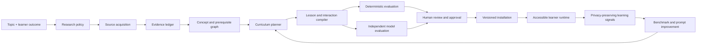

# Learning Harness product roadmap

Status: proposed  
Planning horizon: v0.2 to v1.0  
Assumption: one to two core engineers, with educators and subject-matter reviewers available at release gates

No generative system is literally foolproof. This roadmap instead aims for **failure containment**: unsupported claims, unsafe interactions, stale approvals, model drift, runaway cost, and accidental publication should be caught early, made visible, and prevented from reaching learners.

## North star

Given a topic, audience, observable learning outcome, and evidence policy, Learning Harness should produce a source-grounded interactive course that:

- teaches a transferable mental model rather than summarizing a topic;
- connects every material factual claim to an exact source locator;
- uses diagrams and interactions only when they improve understanding;
- measures prediction, retrieval, explanation, and transfer;
- can be resumed, reproduced, reviewed, and compared across model versions;
- cannot be installed or published until deterministic, model, accessibility, and human gates pass.

The primary product is the `learn` CLI. The website is the renderer and learner experience. Models are replaceable compiler workers, not the system of record.

## Non-negotiable invariants

1. **Evidence before prose.** Research and claim extraction must finish before outlining or lesson writing.
2. **Exact provenance.** Supported claims require source IDs and locators such as page, section, heading, or timestamp.
3. **Visible uncertainty.** Inference, disagreement, missing evidence, and illustrative teaching models remain explicitly labeled.
4. **No generated executable code in lessons.** Interactions compile from versioned declarative primitives. Arbitrary model-authored JavaScript is rejected.
5. **Independent gates.** The authoring model cannot be the only evaluator. Deterministic checks and human review remain mandatory.
6. **Content-bound approval.** Approval is bound to hashes of the lesson, evidence, evaluation, schema, prompts, provider, and model.
7. **No autonomous publishing.** Generation, approval, installation, and deployment remain separate explicit actions.
8. **No silent configuration.** Provider, model, prompt version, budgets, and quality thresholds are recorded for every run.
9. **Accessible by construction.** Generated output targets WCAG 2.2 AA, keyboard operation, reduced motion, narrow screens, and meaningful text alternatives.
10. **Privacy by default.** Learner notes and telemetry remain local unless the operator explicitly enables storage or export.

## Current baseline

The repository already has:

- a live-provider CLI for OpenAI and Anthropic;
- durable brief, source, claim, plan, interaction, lesson, evaluation, review, and approval artifacts;
- structured model outputs and bounded repair attempts;
- deterministic content gates and hash-bound human approval;
- a declarative renderer with prose, maps, comparisons, simulators, evidence, quizzes, takeaways, and exercises;
- a research-job format with source diversity, coverage, contradiction, prerequisite, and packaging checks;
- unit, contract, research, rendering, build, and lint checks.

The largest gaps are:

- no calibrated benchmark demonstrating that generated lessons are accurate or educationally effective;
- research and lesson generation are separate operator flows rather than one coherent CLI workflow;
- limited source ingestion and citation-locator verification;
- no schema migration strategy or compatibility contract;
- no browser-level interaction, accessibility, or visual-regression suite;
- no provider cost, latency, token, or failure telemetry;
- no real learner study or feedback loop;
- no hardened release and publishing policy.

## Target architecture



Every arrow produces a versioned artifact. No stage should depend on reconstructing an earlier chat session.

## Milestone sequence

Estimates are calendar ranges, not commitments. A phase starts only when its prerequisite gate passes. With one to two engineers, the path to a defensible v1.0 is approximately six to nine months.

### Phase 0 — Stabilize v0.2

Estimate: 1–2 weeks

Objective: establish one clean, reproducible baseline before adding capabilities.

Deliverables:

- reconcile and commit the current CLI and research work;
- freeze artifact contract v1 and add `schemaVersion` to every artifact;
- run one paid smoke test through OpenAI and one through Anthropic;
- record provider responses, cost, latency, model IDs, prompt versions, and failure categories without recording credentials;
- add CLI smoke tests for interruption, resume, blocked evaluation, approval invalidation, and overwrite protection;
- document supported Node versions and a repeatable installation path;
- create a release checklist and changelog.

Exit gate:

- fresh clone → install → `learn doctor` → generation → resume → review → approval → installation works on macOS and Linux;
- both live providers complete the same brief or fail with an actionable, durable error;
- no uncommitted production changes and all existing checks pass.

### Phase 1 — Build the benchmark before optimizing

Estimate: 3–4 weeks

Objective: create the evidence needed to judge every later change.

Deliverables:

- a versioned benchmark of 20–30 briefs across technical, scientific, historical, and procedural topics;
- adversarial cases covering disputed claims, thin evidence, source conflicts, prompt injection, inaccessible interactions, and misleading quantitative examples;
- a blinded human rubric for factual grounding, source fidelity, mental-model quality, misconception diagnosis, interaction integrity, accessibility, and transfer;
- at least two independent reviewers for an initial calibration subset;
- a benchmark runner that compares prompts, models, cost, latency, gate failures, and reviewer scores;
- a frozen regression subset that is never used to tune prompts.

Starting release thresholds, to be recalibrated from reviewer agreement:

- zero invented source URLs or citation locators;
- 100% of supported claims linked to known evidence records;
- at least 95% citation entailment precision on the human-audited subset;
- zero critical accessibility, security, or installation-gate failures;
- no regression greater than five percentage points on any quality dimension without an explicit release waiver.

Exit gate:

- reviewer agreement is measured and disagreements have an adjudication process;
- a model or prompt change cannot merge without a benchmark comparison report;
- thresholds are encoded in repository configuration rather than hidden in prompts.

### Phase 2 — Unify and harden research

Estimate: 4–6 weeks

Objective: turn a topic into a trustworthy, bounded evidence pack through one resumable workflow.

Deliverables:

- unify research under `learn research`, `learn audit`, and `learn build`;
- explicit research budgets for rounds, sources, wall time, tokens, and estimated cost;
- source adapters for HTML, text, PDF, and transcript input, each preserving canonical URL and exact locators;
- source-quality policy for primary sources, independent corroboration, recency, conflicts, retractions, and inaccessible material;
- canonicalization, duplicate detection, content hashing, and retrieval timestamps;
- prompt-injection handling that treats all source text as untrusted data;
- claim-to-source verification that checks whether the cited passage actually supports the claim;
- a manual-import path for books, paywalled sources, and private documents without copying excessive copyrighted text;
- license and robots-policy review before any broad automated crawling.

Open-source strategy:

- reuse the STORM pattern of diverse perspective discovery and pre-writing synthesis, but retain the repository’s stricter evidence ledger and stopping gates;
- run a short bake-off before selecting a PDF parser; locator fidelity, tables, OCR behavior, maintenance, and license matter more than extraction speed;
- do not introduce a vector database until benchmark evidence shows that simple indexed retrieval is the bottleneck.

Exit gate:

- the benchmark’s HTML, PDF, transcript, conflicting-source, and unavailable-source cases produce exact, reviewable provenance;
- an injected instruction inside a source cannot alter workflow policy or tool behavior;
- exhausted research budgets end in `blocked` with unresolved gaps, never fabricated closure.

### Phase 3 — Make the compiler measurable and reproducible

Estimate: 3–5 weeks

Objective: make generation deterministic around the model, diagnosable, and safe to evolve.

Deliverables:

- content-addressed stage cache keyed by inputs, schemas, prompts, provider, and model;
- atomic checkpoints, cancellation handling, retry classification, and resumable failed stages;
- JSON Schema validation using a standards-compliant validator rather than shape-only checks;
- artifact migrations with backward-compatibility fixtures for every supported schema version;
- separate author, factual critic, pedagogical critic, and repair roles, with configurable provider diversity;
- model output and source size limits before material enters prompts or artifacts;
- cost estimation before a run and actual cost/token accounting afterward;
- OpenTelemetry-compatible traces for stages, retries, latency, and failures, with content and credentials excluded by default;
- reproducibility reports that distinguish deterministic artifacts from model-dependent output.

Exit gate:

- killing the CLI during every stage and rerunning never corrupts or silently reuses incompatible artifacts;
- changing a source, prompt, schema, provider, or model invalidates only the affected downstream stages;
- every failed run reports the stage, category, safe retry action, and preserved artifacts.

### Phase 4 — Raise the interactive-content ceiling

Estimate: 4–6 weeks

Objective: equal or exceed the reference sites without allowing uncontrolled generated UI.

Deliverables:

- schema-versioned primitive SDK with behavioral and accessibility contracts;
- deterministic rendering for diagrams, timelines, state machines, causal graphs, parameter plots, annotated code, and step-through processes;
- prediction-before-reveal and stateful mastery patterns shared across primitives;
- authored fallback text and printable/static representations for every interaction;
- responsive, keyboard, screen-reader, reduced-motion, and high-contrast behavior;
- Playwright browser tests for every primitive state and narrow-screen route;
- automated accessibility checks plus scheduled manual screen-reader review;
- visual regression snapshots for renderer changes;
- interaction integrity checks proving that controls alter the stated explanatory relationship;
- schema migration tooling so old lessons remain renderable.

Exit gate:

- every primitive passes its contract suite and a manual accessibility checklist;
- generated lessons contain no arbitrary scripts, unsafe HTML, or external embeds by default;
- a lesson remains understandable when interactions, animation, or JavaScript are unavailable;
- the renderer meets the project’s documented WCAG 2.2 AA target.

### Phase 5 — Make the CLI feel like a professional agent tool

Estimate: 3–4 weeks

Objective: make the safe path the easiest path for a first-time operator.

Target command flow:

```text
learn init
learn research "topic" --audience "..." --outcome "..."
learn plan <run>
learn build <run>
learn eval <run>
learn review <run>
learn approve <run>
learn serve <run>
learn install <run>
```

Deliverables:

- interactive onboarding with explicit provider/model selection and a non-secret project config;
- clear streaming stage progress, elapsed time, estimated/actual cost, and cancellation behavior;
- `--json` parity for every command and stable exit-code documentation;
- `learn explain <run>` for provenance, reuse decisions, scores, and blockers;
- `learn diff <run-a> <run-b>` for evidence, prompt, lesson, evaluation, cost, and model changes;
- `learn clean` limited to explicit run IDs with a preview and recoverable behavior;
- shell completion and install verification;
- structured errors with one recommended recovery action;
- no hidden provider fallback and no default model that can change silently.

Exit gate:

- five first-time users can complete the golden path without maintainer intervention;
- interruption, missing configuration, provider refusal, rate limiting, invalid output, and stale approval have tested recovery paths;
- all commands behave consistently in interactive and CI environments.

### Phase 6 — Prove learning value

Estimate: 6–8 weeks, overlapping only after the benchmark and renderer gates

Objective: optimize for learning, not visual polish or model-judge scores.

Deliverables:

- informed-consent and privacy design for learner studies;
- pre-test, embedded prediction, delayed retrieval, and transfer measures;
- event schema for starts, section completion, predictions, attempts, hints, simulator changes, abandonment, and exercise completion;
- local-first progress with explicit opt-in export;
- content/version identifiers on every event so results remain attributable;
- small comparative studies against static prose and the strongest available reference format;
- qualitative interviews focused on confusion, trust, pacing, and transfer;
- a process for turning findings into benchmark cases rather than one-off prompt tweaks.

Primary product metrics:

- improvement from pre-test to immediate post-test;
- delayed retention after an appropriate interval;
- transfer-task completion and quality;
- misconception correction rate after diagnostic feedback;
- completion and abandonment by section and primitive;
- learner trust calibration: whether sourced, inferred, disputed, and illustrative content is understood correctly.

Exit gate:

- at least two representative courses show a measurable learning advantage or a clear usability advantage at equivalent learning outcomes;
- telemetry can be disabled completely without breaking lessons;
- findings produce reproducible changes to rubrics, schemas, or primitives.

### Phase 7 — Operational hardening and v1.0

Estimate: 4–6 weeks

Objective: support dependable repeated use without weakening editorial control.

Deliverables:

- threat model covering prompt injection, SSRF, malicious files, path traversal, unsafe embeds, secret leakage, and dependency compromise;
- allowlisted network behavior, bounded downloads, MIME verification, and isolated parsing;
- release provenance, dependency audit, reproducible package contents, and signed version tags;
- backup and migration policy for runs, research jobs, approvals, and learner progress;
- provider outage and quota runbooks;
- performance budgets for CLI startup, lesson load, interaction response, and build size;
- versioned support policy for Node, schemas, providers, and stored artifacts;
- documented incident, rollback, deprecation, and data-deletion procedures;
- private deployment gate followed by an explicit public-release gate.

v1.0 exit gate:

- all benchmark, accessibility, security, migration, recovery, and live-provider suites pass;
- no unresolved critical or high-severity defects;
- approval provenance survives export, installation, and deployment;
- the project has evidence that at least two courses improve or preserve learning outcomes compared with their baseline;
- operators can recover from a failed run or bad release using documented commands.

## Release ladder

| Release | Audience | Required evidence |
| --- | --- | --- |
| v0.3 internal alpha | Maintainers and invited reviewers | Live provider smoke tests, benchmark runner, artifact v1 |
| v0.5 author alpha | Technical authors | Hardened research, provenance, resume and migration tests |
| v0.7 learner beta | Small consented learner cohort | Accessible primitive suite, privacy controls, study instrumentation |
| v0.9 release candidate | Broader invited cohort | Security review, recovery drills, benchmark and study thresholds |
| v1.0 | Supported users | All release gates, documented support policy, rollback path |

## Execution controls

Every roadmap item must name:

- one accountable owner;
- the acceptance criterion it changes;
- the artifact or code path it owns;
- the exact automated and human verification required;
- the operational, security, privacy, and accessibility risk;
- the rollback or migration path.

Work may be explored ahead of the active phase, but it does not merge into a release path before the prerequisite exit gate passes. Schema, threshold, evidence-policy, and publishing changes require a short decision record. A gate may be waived only by a named release owner, with the failed evidence, reason, scope, expiry, and follow-up recorded in the release report. Critical grounding, security, privacy, and approval-integrity gates are never waivable.

At the end of each milestone:

1. run the full benchmark and verification suite;
2. compare quality, cost, latency, and failures with the last accepted baseline;
3. review unresolved risks and expired waivers;
4. publish a concise internal release report;
5. either accept the milestone, extend it with named blockers, or reduce scope explicitly.

## Scorecard

Every release report should include the same dimensions:

| Dimension | Measurement |
| --- | --- |
| Grounding | Invented citations, locator validity, claim entailment precision, unresolved contradictions |
| Pedagogy | Human rubric, misconception quality, prediction/retrieval coverage, transfer alignment |
| Learning | Immediate gain, delayed retention, transfer performance, trust calibration |
| Interaction | Contract failures, explanatory-state coverage, fallback quality |
| Accessibility | Automated violations, keyboard suite, screen-reader findings, WCAG 2.2 AA review |
| Reliability | Completion rate, resume success, corruption incidents, provider failure recovery |
| Efficiency | Cost per approved lesson, wall time, model calls, cache reuse, reviewer time |
| Safety | Prompt-injection failures, unsafe content, secret exposure, stale approvals, publish bypasses |

Thresholds belong in versioned configuration and release reports. They must not be lowered automatically to make a release pass.

## Risk register

| Risk | Prevention | Detection | Recovery |
| --- | --- | --- | --- |
| Fluent but unsupported claims | Evidence-first pipeline and locator requirement | Entailment checks plus human sampling | Block claim and reopen research |
| Source bias or false corroboration | Independence groups and primary-source policy | Diversity and contradiction audit | Narrow claim or mark disputed |
| Model-judge self-preference | Independent deterministic and human gates | Cross-provider benchmark comparisons | Re-score and quarantine regression |
| Decorative or misleading interaction | Primitive contracts and causal-variable requirements | State-coverage and learner tests | Fall back to static explanation |
| Prompt injection from sources | Untrusted-data boundary and restricted tools | Adversarial benchmark | Quarantine source and invalidate downstream artifacts |
| Stale approval | Content-addressed approval | Hash verification at install/deploy | Require fresh evaluation and approval |
| Cost runaway | Preflight budgets and bounded loops | Per-stage cost telemetry | Stop safely with resumable state |
| Schema drift | Versions, migrations, compatibility corpus | Old-artifact CI | Migrate or render supported fallback |
| Privacy leakage | Local-first storage and data minimization | Data-flow review and redaction tests | Delete/export tooling and incident process |
| Platform overbuilding | Benchmark-first sequencing | Milestone exit gates | Stop work that does not improve a scorecard dimension |

## Open-source adoption policy

Adopt a dependency only when a benchmark or operational requirement demonstrates the need. For each candidate, record maintenance activity, license, bundle/runtime cost, security history, accessibility impact, data handling, replacement cost, and an exit strategy.

Recommended direction:

- **Adopt after a spike:** a standards-compliant JSON Schema validator, Playwright for browser contracts, an accessibility engine used alongside human review, and OpenTelemetry-compatible instrumentation.
- **Reuse as a pattern:** STORM for multi-perspective pre-writing and evidence-oriented outlining.
- **Evaluate only after the benchmark exists:** DSPy or other prompt optimizers, because optimizing against an uncalibrated metric will harden the wrong behavior.
- **Defer:** vector databases, autonomous multi-agent orchestration, arbitrary generated React components, LMS standards, marketplace plugins, and public multi-tenant hosting.

The accessibility target follows the W3C’s [WCAG 2.2 Recommendation](https://www.w3.org/TR/WCAG22/). Operational telemetry should follow the vendor-neutral concepts in the [OpenTelemetry documentation](https://opentelemetry.io/docs/concepts/observability-primer/). The research architecture may borrow the pre-writing separation described in the [STORM paper](https://arxiv.org/abs/2402.14207), without adopting its pipeline wholesale.

## First 30 days

### Week 1

- clean and tag the v0.2 baseline;
- add artifact schema versions;
- run and document one OpenAI and one Anthropic end-to-end smoke test;
- create the release checklist and failure taxonomy.

### Week 2

- write the benchmark rubric and reviewer guide;
- author five representative briefs and five adversarial briefs;
- build the benchmark result format and comparison command.

### Week 3

- calibrate two reviewers on a small set;
- identify ambiguous rubric items;
- freeze the first regression subset;
- encode initial release thresholds.

### Week 4

- add interruption/resume tests for every pipeline stage;
- add model, prompt, schema, and source invalidation tests;
- publish the first internal quality report;
- decide whether Phase 2 starts or Phase 1 needs another calibration cycle.

## Explicitly not next

Do not build these before the benchmark and evidence engine are trustworthy:

- a plugin marketplace;
- autonomous public web crawling;
- generated executable UI code;
- a multi-tenant SaaS control plane;
- gamification or social features;
- automated public publishing;
- model fine-tuning;
- a vector database introduced only because it is fashionable.

The immediate strategic rule is simple: **prove truthfulness and learning value first; scale formats, automation, and distribution second.**
